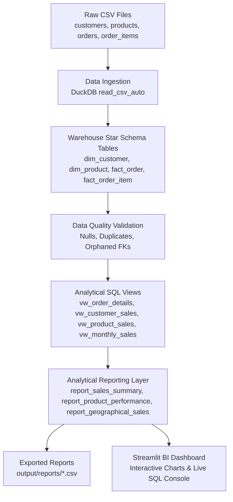
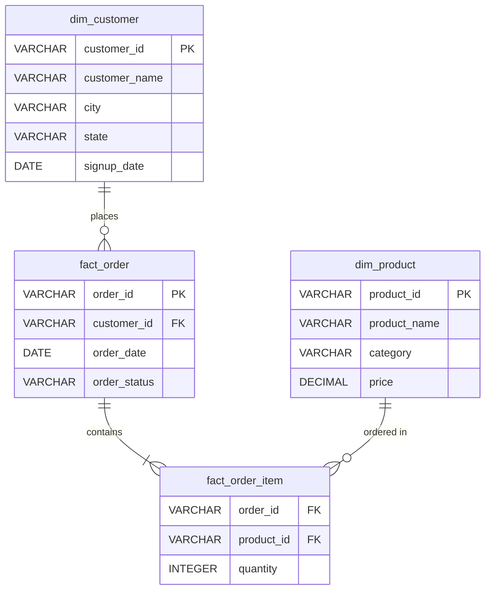

# Mini Data Warehouse using DuckDB and Python
**BTech 3rd-Year Data Engineering Practical Case Study**  
*Case Study: E-Commerce Sales Analytics Mini Data Warehouse*

---

## 1. Project Title
**Mini Data Warehouse using DuckDB and Python: E-Commerce Sales Analytics**

---

## 2. Problem Statement
Modern e-commerce businesses generate thousands of daily transactions recorded in disparate raw files (orders, customers, products, and line items). Traditional transactional databases (OLTP) are optimized for fast writes rather than high-performance complex analytical queries (OLAP). 

Organizations require a **Data Warehouse** architecture to:
- Consolidate raw multi-source CSV files into a centralized analytical database.
- Enforce schema design and data quality validation.
- Perform multi-dataset joins and transformations.
- Provide pre-aggregated analytical views and reporting layers for business intelligence (BI) dashboards.

This practical case study implements a local, high-performance, embedded **Mini Data Warehouse** using **DuckDB**, **Python**, and **SQL**.

---

## 3. Project Objective
1. **Load Multiple Datasets:** Automatically generate and ingest 4 relational e-commerce CSV datasets (`customers`, `products`, `orders`, `order_items`).
2. **Star Schema Design:** Organize data into Dimension Tables (`dim_customer`, `dim_product`) and Fact Tables (`fact_order`, `fact_order_item`).
3. **Data Quality Validation:** Verify primary keys, detect nulls, eliminate duplicates, and enforce foreign key referential integrity.
4. **Dataset Joins & Transformations:** Build unified analytical SQL views using `INNER JOIN` and `LEFT JOIN` operations.
5. **Calculate Core Business Metrics:** Compute Total Revenue, Average Order Value (AOV), Average Selling Price (ASP), Top Products, Category Performance, and Regional Sales.
6. **Analytical Reporting Layer:** Export business-ready analytical datasets to CSV files.
7. **Interactive BI Dashboard:** Provide a web-based Streamlit dashboard with real-time KPI metrics, interactive charts, and a live SQL query console.

---

## 4. Technologies Used
- **Language:** Python 3 (Pipeline orchestration, data generation, data quality validation)
- **Data Warehouse Engine:** DuckDB (In-process SQL OLAP database optimized for columnar analytical queries)
- **Query Language:** Standard SQL (DDL table creation, joins, aggregations, window functions, and views)
- **Data Processing:** Pandas (CSV serialization, tabular manipulation)
- **Reporting Dashboard:** Streamlit (Interactive analytics web application)
- **Visualization:** Plotly Express & Plotly Graph Objects (Interactive charts)
- **Environment:** Runs 100% locally on Windows without requiring Docker, Hadoop, Spark, or Cloud services.

---

## 5. Dataset Description

The warehouse ingests four synthetic datasets simulating an Indian e-commerce enterprise:

| Dataset | Records | Description & Key Columns |
| :--- | :--- | :--- |
| `customers.csv` | 50 records | `customer_id`, `customer_name`, `city`, `state`, `signup_date` |
| `products.csv` | 30 records | `product_id`, `product_name`, `category`, `price` |
| `orders.csv` | 200 records | `order_id`, `customer_id`, `order_date`, `order_status` |
| `order_items.csv` | 500+ records | `order_id`, `product_id`, `quantity` |

### Relational Integrity:
- `customers.customer_id` $\rightarrow$ `orders.customer_id` (1-to-Many)
- `orders.order_id` $\rightarrow$ `order_items.order_id` (1-to-Many)
- `products.product_id` $\rightarrow$ `order_items.product_id` (1-to-Many)

---

## 6. Data Warehouse Architecture

The project follows the standard modern data warehousing pipeline:



---

## 7. Star Schema Design

In a data warehouse, a **Star Schema** separates descriptive business context (**Dimensions**) from numeric transactional measurements (**Facts**).



- **Dimension Tables:**
  - `dim_customer`: Descriptive attributes about customers (Name, City, State, Signup Date).
  - `dim_product`: Descriptive attributes about products (Product Name, Category, Unit Price).
- **Fact Tables:**
  - `fact_order`: Transaction header capturing order dates and fulfillment status.
  - `fact_order_item`: Granular line-item facts containing numeric purchase quantities.

---

## 8. Project Folder Structure

```
mini_data_warehouse/
│
├── data/                               # Raw CSV datasets
│   ├── customers.csv
│   ├── products.csv
│   ├── orders.csv
│   └── order_items.csv
│
├── output/
│   └── reports/                        # Exported business CSV reports
│       ├── sales_summary.csv
│       ├── product_performance.csv
│       ├── customer_performance.csv
│       ├── monthly_sales.csv
│       └── state_sales.csv
│
├── src/                                # Python warehouse pipeline modules
│   ├── generate_data.py                # Synthetic dataset generator
│   ├── load_data.py                    # DuckDB table loader & DDL executor
│   ├── transform.py                    # Data validation & view builder
│   ├── analytics.py                    # Business metrics calculator & exporter
│   └── main.py                         # End-to-end pipeline orchestrator
│
├── dashboard/
│   └── app.py                          # Streamlit analytical web dashboard
│
├── sql/                                # Pure SQL scripts for practical demonstration
│   ├── create_tables.sql               # Star Schema table definitions (DDL)
│   ├── create_views.sql                # Analytical & reporting views (DML/Views)
│   └── analytical_queries.sql          # Business KPI standalone queries
│
├── duckdb/
│   └── ecommerce.duckdb                # Central DuckDB Data Warehouse file
│
├── requirements.txt                    # Project Python dependencies
├── README.md                           # Comprehensive documentation & Viva guide
└── run_project.bat                     # Windows batch menu launcher
```

---

## 9. Step-by-Step Execution Guide

### Prerequisites:
- Python 3.10 or newer installed on Windows.

### Step 1: Install Dependencies
Open PowerShell or Command Prompt in the project folder and run:
```bash
python -m pip install -r requirements.txt
```

### Step 2: Run the Complete Data Warehouse Pipeline
Execute the main orchestrator script:
```bash
python src/main.py
```
This automatically:
1. Generates the 4 CSV files in `data/`.
2. Connects to `duckdb/ecommerce.duckdb`.
3. Creates the Star Schema tables (`dim_customer`, `dim_product`, `fact_order`, `fact_order_item`).
4. Ingests the CSV records into DuckDB.
5. Runs data quality checks and displays a validation report.
6. Builds analytical views (`vw_order_details`, `vw_customer_sales`, etc.).
7. Computes business metrics (Revenue, AOV, ASP, Top Products).
8. Exports 5 analytical CSV reports to `output/reports/`.

### Step 3: Launch the Streamlit Reporting Dashboard
```bash
python -m streamlit run dashboard/app.py
```
Open your browser at `http://localhost:8501` to interact with:
- KPI summary cards
- Monthly revenue trends & Category breakdowns
- Top products & State-level sales
- Warehouse table & view explorer
- **Live SQL Query Console** for practical demonstration

### Quick Launch using Windows Batch File:
You can also double-click `run_project.bat` to launch an interactive menu.

---

## 10. SQL Operations Used

| SQL Operation | Description & Practical Purpose |
| :--- | :--- |
| `CREATE TABLE` | DDL to define dimension and fact table schemas with data types. |
| `read_csv_auto()` | DuckDB native vectorized function to load CSVs directly into tables. |
| `CREATE VIEW` | Virtual tables encapsulating complex analytical multi-table joins. |
| `INNER JOIN` | Combines matching rows between facts and dimensions for granular order line items. |
| `LEFT JOIN` | Preserves all dimension rows even if no orders exist (customer/product sales views). |
| `GROUP BY` | Aggregates metrics by Customer, Product, Category, State, and Month. |
| `COUNT(DISTINCT ...)` | Calculates unique orders, unique customers, and unique products. |
| `SUM(quantity * price)`| Computes total financial sales amount. |
| `strftime(date, '%Y-%m')` | Extracts year-month string for temporal time-series aggregation. |
| `RANK() OVER (...)` | Window function to rank products and customers by total revenue. |

---

## 11. SQL Joins Demonstration

The primary analytical view `vw_order_details` is constructed using multi-table joins:

```sql
SELECT 
    fo.order_id,
    fo.order_date,
    fo.customer_id,
    dc.customer_name,
    dc.city,
    dc.state,
    foi.product_id,
    dp.product_name,
    dp.category,
    foi.quantity,
    dp.price AS unit_price,
    CAST(foi.quantity * dp.price AS DECIMAL(12, 2)) AS sales_amount,
    fo.order_status
FROM fact_order fo
INNER JOIN fact_order_item foi 
    ON fo.order_id = foi.order_id
INNER JOIN dim_customer dc 
    ON fo.customer_id = dc.customer_id
INNER JOIN dim_product dp 
    ON foi.product_id = dp.product_id;
```

---

## 12. Core Business Metrics Computed

1. **Total Revenue:** $\sum (\text{quantity} \times \text{unit\_price}) \approx ₹36,00,000+$
2. **Total Orders:** Count of unique `order_id` records ($200$).
3. **Total Customers:** Count of unique `customer_id` records ($50$).
4. **Total Products in Catalog:** Count of unique `product_id` records ($30$).
5. **Total Units Sold:** Total quantity of physical items purchased ($900+$ units).
6. **Average Order Value (AOV):** $\frac{\text{Total Revenue}}{\text{Total Orders}} \approx ₹18,000+$.
7. **Average Selling Price (ASP):** $\frac{\text{Total Revenue}}{\text{Total Units Sold}} \approx ₹3,800+$.
8. **Top 5 Products by Revenue:** 4K Smart LED TV, 5G Smartphone, Solid Wood Study Desk, etc.
9. **Top Categories:** Electronics, Furniture, Wearables, Clothing, Footwear.
10. **Geographical Performance:** Top revenue-generating Indian states (Maharashtra, Rajasthan, Uttar Pradesh, Karnataka, etc.).
11. **Order Fulfillment Distribution:** Breakdown of Delivered, Shipped, Processing, and Returned orders.

---

## 13. Analytical Reporting Layer

The warehouse defines specialized reporting views designed for business analysts and decision makers:

| Report View | Exported File | Business Value |
| :--- | :--- | :--- |
| `report_sales_summary` | `output/reports/sales_summary.csv` | Executive KPI dashboard metrics. |
| `report_product_performance` | `output/reports/product_performance.csv` | Product ranking by revenue and volume. |
| `report_customer_performance`| `output/reports/customer_performance.csv`| Customer lifetime spend & loyalty ranking. |
| `report_monthly_sales` | `output/reports/monthly_sales.csv` | Monthly revenue growth and order trajectory. |
| `report_geographical_sales` | `output/reports/state_sales.csv` | Regional sales density and customer concentration. |

---

## 14. Streamlit Reporting Dashboard

The interactive dashboard in `dashboard/app.py` connects directly to `duckdb/ecommerce.duckdb` in read-only mode:

### Key Features:
1. **Interactive Filters:** Filter by Date Range, Product Category, Customer State, and Order Status.
2. **Dynamic KPI Cards:** Instant recalculation of Revenue, Orders, Customers, Units, and AOV.
3. **Visual Charts:**
   - Monthly Revenue Trend (Plotly Line Chart)
   - Category Revenue Share (Plotly Donut Chart)
   - Top 5 Products by Sales (Plotly Horizontal Bar Chart)
   - State-wise Performance (Plotly Colored Bar Chart)
   - Order Status Distribution (Plotly Pie Chart)
4. **Warehouse Table & View Explorer:** Direct view of top rows across all dimensions, facts, and views.
5. **Live SQL Query Console:** Execute custom SQL queries on DuckDB directly within the UI.
6. **Report Downloads:** Single-click CSV download buttons for all 5 analytical reports.

---

## 15. Expected Terminal Output

When running `python src/main.py`:

```
==================================================
      MINI DATA WAREHOUSE USING DUCKDB        
   E-Commerce Sales Analytics Practical Case  
==================================================

[1] Generating / verifying CSV datasets...
[OK] Existing datasets detected. Loaded from disk:
    - Customers:   50 records
    - Products:    30 records
    - Orders:      200 records
    - Order Items: 519 records
    ✓ Customers:   50 records
    ✓ Products:    30 records
    ✓ Orders:      200 records
    ✓ Order Items: 519 records

[2] Loading data into DuckDB warehouse (Star Schema)...
---------------------------------------------
Table Name                | Row Count      
---------------------------------------------
dim_customer              | 50             
dim_product               | 30             
fact_order                | 200            
fact_order_item           | 519            
---------------------------------------------
    ✓ dim_customer loaded
    ✓ dim_product loaded
    ✓ fact_order loaded
    ✓ fact_order_item loaded

[3] Performing data quality validation...
========================================
         DATA QUALITY REPORT            
========================================
Customers with NULL ID:          0
Products with NULL ID:           0
Orders with NULL ID:             0
Duplicate Orders:                0
Invalid Quantities (<= 0):       0
Invalid Prices (<= 0):           0
Orders with Missing Customers:   0
Items with Missing Orders:       0
Items with Missing Products:     0
----------------------------------------
[✓] Data Quality Verification: PASSED (100% Clean Data)
========================================

    ✓ No NULL primary keys
    ✓ No duplicate orders
    ✓ No invalid quantities or prices
    ✓ Strict referential integrity verified

[4] Creating analytical views & star-schema joins...
[*] Creating Analytical Views and Reporting Layer...
    [✓] View 'vw_order_details' verified (519 rows)
    [✓] View 'vw_customer_sales' verified (50 rows)
    [✓] View 'vw_product_sales' verified (30 rows)
    [✓] View 'vw_monthly_sales' verified (12 rows)
    [✓] View 'report_sales_summary' verified (1 rows)
    [✓] View 'report_product_performance' verified (30 rows)
    [✓] View 'report_customer_performance' verified (50 rows)
    [✓] View 'report_monthly_sales' verified (12 rows)
    [✓] View 'report_geographical_sales' verified (14 rows)
    ✓ vw_order_details (Multi-table INNER JOIN)
    ✓ vw_customer_sales (Customer aggregated sales)
    ✓ vw_product_sales (Product sales by category)
    ✓ vw_monthly_sales (Monthly trend analysis)
    ✓ 5 Reporting Layer views initialized

[5] Calculating e-commerce business metrics...
[*] Calculating Core E-Commerce Business Metrics...

    ---------------------------------------
    Total Revenue:            ₹3,606,312.00
    Total Orders:             200
    Total Customers:          49
    Total Units Sold:         938
    Average Order Value:      ₹18,031.56
    Average Selling Price:    ₹3,844.68
    ---------------------------------------

[6] Generating analytical reports...
[*] Exporting Analytical Reporting Datasets to output/reports/...
    [✓] sales_summary.csv            (1 rows exported)
    [✓] product_performance.csv      (30 rows exported)
    [✓] customer_performance.csv     (50 rows exported)
    [✓] monthly_sales.csv            (12 rows exported)
    [✓] state_sales.csv              (14 rows exported)
[✓] All 5 analytical reports successfully exported!
    ✓ Reports exported to output/reports/

==================================================
      PIPELINE COMPLETED SUCCESSFULLY!        
==================================================
```

---

## 16. Conclusion

This practical project successfully demonstrates:
1. **ELT Workflow:** Ingesting raw CSV data directly into an analytical database and performing in-warehouse SQL transformations.
2. **Columnar OLAP Benefits:** How DuckDB provides fast analytical querying on local disk without heavy database server infrastructure.
3. **Star Schema Implementation:** Separation of business dimensions and transactional facts for analytical simplicity.
4. **End-to-End Delivery:** Moving from raw unstructured/semi-structured files to automated data quality checks, relational joins, business metric calculations, and interactive BI reporting.

---

## 17. College Viva Questions & Answers

### Q1: What is DuckDB and why is it used for a Data Warehouse instead of SQLite or MySQL?
**Answer:** DuckDB is an embedded, in-process **OLAP (Online Analytical Processing)** database engine designed for analytical queries. Unlike SQLite or MySQL which are row-oriented (OLTP) and slow at scanning millions of rows, DuckDB uses a **columnar storage format** and **vectorized query execution**. This makes DuckDB fast at aggregations (`SUM`, `AVG`, `COUNT`), joins, and scanning CSV/Parquet files directly.

### Q2: What is a Star Schema and what are Fact vs Dimension tables?
**Answer:** A **Star Schema** is a data warehouse schema where a central Fact table connects to surrounding Dimension tables.
- **Fact Table:** Stores numerical, measurable business events (e.g., `fact_order_item` stores `quantity`, and `fact_order` stores `order_date`).
- **Dimension Table:** Stores descriptive context or attributes about the facts (e.g., `dim_customer` contains customer name, city, state; `dim_product` contains product name, category, unit price).

### Q3: What is the difference between OLTP and OLAP?
**Answer:**
- **OLTP (Online Transaction Processing):** Optimized for high volumes of fast, single-row inserts, updates, and deletes (e.g., banking transactions, placing an order). Uses row-oriented storage (e.g., PostgreSQL, MySQL).
- **OLAP (Online Analytical Processing):** Optimized for complex multi-table aggregations, scans, and analytical reporting over large datasets. Uses columnar storage (e.g., DuckDB, Snowflake, BigQuery).

### Q4: Why do we use Views instead of storing joined data into another physical table?
**Answer:** SQL Views are virtual tables computed on demand from the underlying base tables.
1. **Data Freshness:** Whenever new records are inserted into fact or dimension tables, views reflect the updated data without needing a batch reload.
2. **Storage Efficiency:** Views do not duplicate disk storage.
3. **Security & Abstraction:** Complex multi-table joins are encapsulated into simple virtual interfaces for analysts.

### Q5: What is the difference between INNER JOIN and LEFT JOIN? Give examples from this project.
**Answer:**
- **INNER JOIN:** Returns only records that have matching keys in both tables. Example: `vw_order_details` uses `INNER JOIN` between `fact_order` and `fact_order_item` because a line item must belong to a valid order.
- **LEFT JOIN:** Returns all records from the left table and matched records from the right table (with `NULL` if no match). Example: `vw_customer_sales` uses `LEFT JOIN` on `dim_customer` so customers who haven't placed an order yet are still displayed with 0 sales.

### Q6: How is Average Order Value (AOV) calculated in SQL?
**Answer:**
$$\text{AOV} = \frac{\text{Total Revenue}}{\text{Total Distinct Orders}} = \frac{\sum(\text{quantity} \times \text{unit\_price})}{\text{COUNT(DISTINCT order\_id)}}$$

### Q7: What data validation checks were performed before building analytical views?
**Answer:**
1. **Primary Key Uniqueness & Nullability:** Ensured no `NULL` customer, product, or order IDs.
2. **Duplicate Checks:** Verified order IDs are unique.
3. **Domain Constraints:** Checked that `quantity > 0` and `price > 0`.
4. **Referential Integrity:** Ensured no orphaned orders (missing customer) or orphaned order items (missing product or order).

### Q8: What is an Analytical Reporting Layer?
**Answer:** An Analytical Reporting Layer is the top layer of a data warehouse containing pre-aggregated, business-friendly datasets (e.g., `report_monthly_sales`, `report_product_performance`). It decouples raw data complexity from end-user applications like PowerBI, Tableau, or Streamlit.

### Q9: How does DuckDB connect with Python and Streamlit?
**Answer:** DuckDB provides a native Python library (`import duckdb`). Python scripts connect using `con = duckdb.connect("duckdb/ecommerce.duckdb")`. Queries can be exported directly into Pandas DataFrames using `.fetchdf()`, which are then rendered into interactive UI tables and Plotly charts in Streamlit.

### Q10: How does this mini data warehouse scale compared to cloud data warehouses like Snowflake or BigQuery?
**Answer:** DuckDB is an embedded engine ideal for single-node processing (up to hundreds of gigabytes or tens of millions of rows on a local laptop). For multi-terabyte/petabyte enterprise datasets with hundreds of concurrent users, cloud data warehouses like Snowflake or Google BigQuery use distributed compute clusters. However, DuckDB implements the exact same SQL standards and OLAP columnar principles on a local scale.

---

## 18. Quick Practical Demonstration Checklist for Viva

When presenting to your professor, demonstrate the following 5 points:

1. **Point 1 (Load Datasets):** Show `data/` CSV files and run `python src/load_data.py` to show row counts loaded into DuckDB.
2. **Point 2 (Tables & Views):** Open `sql/create_tables.sql` and `sql/create_views.sql` to explain the Star Schema DDL and Views.
3. **Point 3 (Dataset Joins):** Show the 4-table `INNER JOIN` query in `sql/create_views.sql` for `vw_order_details`.
4. **Point 4 (Business Metrics):** Run `python src/analytics.py` to display Total Revenue, AOV, Top Products, and Category metrics.
5. **Point 5 (Reporting Layer & Dashboard):** Open `output/reports/` to show exported CSVs and launch `python -m streamlit run dashboard/app.py` to show the visual BI dashboard and live SQL console.
